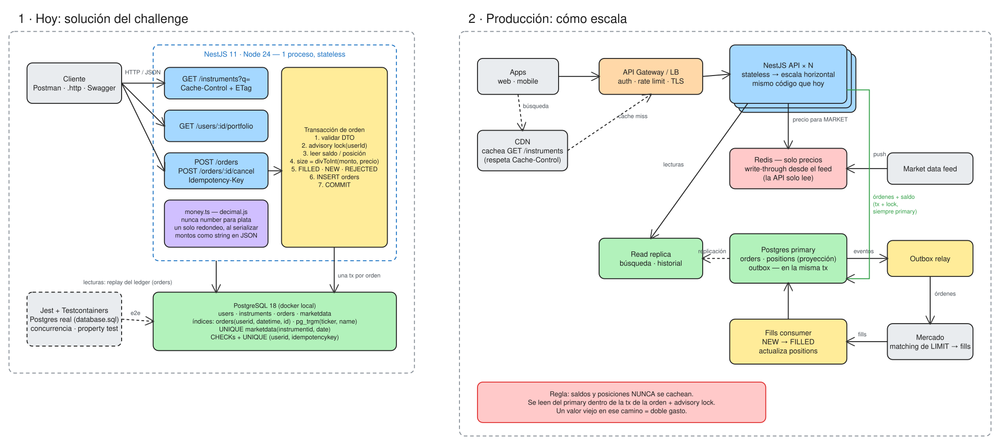

# cocos-challenge-backend

API para consultar el portfolio de un usuario, buscar activos y mandar órdenes al mercado. Es mi resolución del challenge de backend de Cocos.

NestJS 11 · Node 24 · TypeScript · PostgreSQL 18 · Kysely · decimal.js · Jest + Testcontainers

## Levantarlo

Solo hace falta Docker:

```bash
docker compose up --build
```

Levanta Postgres con el `database.sql` del challenge más una migración mía, y la API en `http://localhost:3000`. La documentación de Swagger queda en `/docs`, y en [`requests.http`](requests.http) hay requests listos para probar desde VS Code (REST Client) o JetBrains.

Si ya tenés algo corriendo en el 3000 o el 5432:

```bash
API_PORT=3001 DB_PORT=5433 docker compose up --build
```

Para desarrollar sin Docker para la API (necesitás Node 24, `nvm use`, y pnpm, `corepack enable`):

```bash
pnpm install
pnpm db:up          # solo Postgres
cp .env.example .env
pnpm start:dev
```

Tests:

```bash
pnpm test           # unitarios: aritmética de plata (property test) y el ledger
pnpm test:e2e       # funcionales contra un Postgres real; necesita Docker
pnpm lint
```

## Endpoints

| Método | Ruta | Qué hace |
|---|---|---|
| `GET` | `/instruments?q=` | Busca activos por ticker y/o nombre |
| `GET` | `/users/:userId/portfolio` | Valor total, pesos disponibles y posiciones |
| `POST` | `/orders` | Manda una orden: `BUY`/`SELL` (`MARKET` o `LIMIT`), `CASH_IN`/`CASH_OUT` |
| `POST` | `/orders/:id/cancel` | Cancela una orden en estado `NEW` |
| `GET` | `/health` | 200 si la API llega a Postgres, 503 si no |

En `/docs` está el Swagger completo: cada endpoint documenta qué recibe, qué devuelve y qué errores puede dar, con ejemplos. El JSON de OpenAPI está en `/docs-json` por si lo querés importar en Postman o Insomnia.

### Mandar una orden

```json
{ "userId": 1, "instrumentId": 47, "side": "BUY", "type": "LIMIT", "size": 10, "price": "930.50" }
```

- Se manda `size` (cantidad de acciones) o `amount` (pesos a invertir), uno de los dos. Con `amount` la API calcula cuántas acciones enteras se pueden comprar con esa plata.
- `price` es obligatorio en las `LIMIT`. En las `MARKET` no se manda, porque se ejecutan al último `close`.
- El header `Idempotency-Key` es opcional. Si un cliente reintenta con la misma key, recibe la orden original con un `200` y no se crea una nueva.

Qué devuelve según el caso:

| Caso | HTTP | ¿Se guarda? |
|---|---|---|
| `MARKET` ejecutada | 201, `FILLED` | Sí |
| `LIMIT` aceptada | 201, `NEW` | Sí |
| No alcanzan los pesos o las acciones | 201, `REJECTED` | Sí, como pide el enunciado |
| Body inválido, usuario o instrumento que no existe | 400 / 404 | No |
| `MARKET` sobre un activo sin precio, o un monto que no alcanza para una acción | 422 | No |
| La base no está disponible | 503 + `Retry-After` | No (la transacción se revierte) |

Separé esos casos a propósito. Una orden `REJECTED` está bien formada y el sistema decidió no ejecutarla; eso es parte del historial del usuario y tiene sentido guardarlo. Un request con datos inválidos directamente no es una orden, así que no lo persisto.

Los errores siguen el formato [RFC 9457](https://www.rfc-editor.org/rfc/rfc9457) (`application/problem+json`).

### Portfolio

```json
{
  "userId": 1,
  "accountNumber": "10001",
  "totalValue": "889756.00",
  "availableCash": "627500.00",
  "reservedCash": "125500.00",
  "positions": [
    {
      "instrumentId": 47, "ticker": "PAMP", "name": "Pampa Holding S.A.",
      "quantity": 40, "lastPrice": "925.85", "marketValue": "37034.00",
      "averageCost": "930.00", "totalReturnPct": "-0.45", "dailyReturnPct": "0.44"
    }
  ]
}
```

Los montos van como string a propósito, para que nadie del otro lado los parsee a float.

## Arquitectura



El diagrama está hecho en Excalidraw: [`docs/architecture.excalidraw`](docs/architecture.excalidraw) se puede abrir y editar en [excalidraw.com](https://excalidraw.com) (menú → Open). A la izquierda está lo que hay en este repo; a la derecha, cómo lo haría crecer para producción sin tener que tirar nada de lo que ya está.

```
src/
  common/money.ts          contexto decimal y división truncada
  common/problem.filter.ts errores RFC 9457
  db/database.ts           Kysely, tipos de las tablas y parsers de pg
  instruments/             búsqueda
  portfolio/ledger.ts      cálculo de cash y posiciones (lo usan portfolio y órdenes)
  portfolio/               endpoint de portfolio
  orders/                  envío y cancelación de órdenes
db/migrations/             cambios sobre database.sql
test/api.e2e-spec.ts       tests funcionales
```

No armé una capa de repositorios. Cada service usa Kysely directo: con una sola base y sin planes de cambiarla, una interfaz por repositorio hubiera sido indirección sin nada a cambio.

## Decisiones

### NestJS + Kysely

NestJS me da módulos, inyección de dependencias y validación de DTOs sin tener que inventar una estructura, y cualquiera que lo conozca se ubica rápido en el código. El plugin de Swagger arma la documentación a partir de los DTOs, así que no se desincroniza.

Para la base elegí Kysely en vez de un ORM. El dominio es chico pero las partes delicadas son justamente las que un ORM esconde: transacciones explícitas, un advisory lock, `DISTINCT ON` para el último precio y columnas `numeric`. Kysely tipa las queries contra el esquema y el SQL sigue a la vista. Con TypeORM o Prisma iba a estar peleando contra el mapeo justo en esas partes.

### La plata nunca pasa por `number`

En JavaScript `0.1 + 0.2` da `0.30000000000000004`. En un broker eso no puede pasar, así que:

- El driver de pg convierte `numeric` directo a `decimal.js` ([`db/database.ts`](src/db/database.ts)). Un monto nunca llega a ser float.
- Todas las cuentas usan un único contexto ([`common/money.ts`](src/common/money.ts)) con `ROUND_HALF_UP`, que es como redondea `round()` en Postgres. Así la app y la base no pueden dar resultados distintos.
- Redondeo una sola vez, al armar la respuesta. Redondear en pasos intermedios acumula error.
- Para pasar de pesos a cantidad de acciones uso `divToInt`, que trunca de forma exacta. `div().floor()` redondea el cociente antes de truncar y en algún caso borde te da una acción de más. Hay un property test con fast-check que prueba `qty × price ≤ amount < (qty + 1) × price` sobre miles de combinaciones.
- Si mandás un precio con más de 2 decimales, la API lo rechaza. `orders.price` es `numeric(10,2)` y Postgres lo redondearía sin avisar, y prefiero que el cliente se entere.

### Un solo lugar que calcula saldos

[`portfolio/ledger.ts`](src/portfolio/ledger.ts) recorre las órdenes del usuario en orden cronológico y devuelve cash y posiciones. El portfolio y la validación de órdenes usan esa misma función. Si fueran dos implementaciones, tarde o temprano el portfolio iba a mostrar un saldo distinto del que se valida al operar.

El rendimiento lo calculo contra el costo promedio ponderado: cada compra suma su costo, y cada venta saca costo al promedio vigente. Por eso hace falta recorrer las órdenes en orden. Un `SUM(costo) / SUM(cantidad)` en SQL da mal en cuanto cerrás una posición y la volvés a abrir, y hay un test unitario con ese caso.

### Las órdenes `NEW` reservan saldo

Una `LIMIT` de compra pendiente compromete los pesos que va a usar, y una de venta compromete las acciones. Sin esto, un usuario con $1.000 podría dejar diez órdenes límite de $1.000 cada una. `availableCash` ya descuenta lo reservado, y al cancelar la reserva se libera.

### Concurrencia

Si llegan dos órdenes del mismo usuario al mismo tiempo, las dos leen el mismo saldo, las dos pasan la validación y el usuario gasta dos veces la misma plata. Para evitarlo, cada orden corre en una transacción que arranca con `pg_advisory_xact_lock(userId)`:

- El lock es por usuario, así que no frena a nadie más.
- Es de transacción: se suelta solo con el commit o el rollback, y funciona detrás de un pooler en modo transacción (PgBouncer, el de Neon), donde un lock de sesión no sería confiable.

El primer test de concurrencia que escribí pasaba aunque sacara el lock: en local cada transacción dura un milisegundo y nunca llegaban a pisarse. Lo reescribí para que fuerce la carrera. Bloquea la tabla, espera a que todas las requests estén encoladas y las suelta juntas. Sin el lock, se llenan 5 de 5 órdenes teniendo plata para una sola; con el lock se llena una.

Cancelar no necesita lock: `UPDATE ... WHERE id = $1 AND status = 'NEW'` es atómico, y si dos requests compiten solo una modifica la fila.

### Idempotency-Key

Si el cliente hace timeout y reintenta un `POST /orders`, sin esto compra dos veces. La key se guarda con la orden con un índice único `(userid, idempotencykey)`. Como se chequea adentro del lock del usuario, no hay carrera entre el reintento y el request original.

### Caché, pero solo donde no hace daño

`GET /instruments` responde con `Cache-Control: public, max-age=300`, y Express le agrega el ETag. El catálogo casi no cambia, así que el navegador o un CDN lo pueden cachear sin que yo agregue infraestructura.

Saldos, posiciones y portfolio no se cachean. Un saldo viejo en el camino de una orden es exactamente el doble gasto que el lock está evitando. Tampoco agregué Redis: no tengo un problema medido que lo justifique, y con los índices las queries tardan menos de un milisegundo.

### Cuando se cae la base

Si Postgres no responde, la API no se cuelga ni se cae, y tampoco devuelve un 500 genérico:

- El pool tiene `connectionTimeoutMillis` de 5 s. Si la base no está, el request falla rápido en vez de quedar esperando para siempre.
- `statement_timeout` de 10 s. Una query trabada no puede quedarse con el lock del usuario indefinidamente.
- Los errores de conexión (conexión rechazada, DNS, base reiniciándose, demasiadas conexiones, timeouts) se responden como **503 con `Retry-After: 5`**. Ese 503 le dice al cliente algo útil: el request no se aplicó, porque la transacción se revirtió, y se puede reintentar. En `POST /orders`, si el cliente reintenta con la misma `Idempotency-Key`, no hay riesgo de duplicar la orden.
- Si una conexión ociosa del pool se corta, por ejemplo porque se reinició la base, pg emite un `error` que sin handler tira abajo el proceso. Lo logueo, y el pool abre una conexión nueva en la próxima query.
- `GET /health` hace un `select 1`. Lo usa el healthcheck de `docker compose`, y un load balancer lo usaría igual para sacar de rotación una instancia que no llega a la base.

Lo probé en vivo: con `docker compose stop db` la API responde 503 y sigue arriba, y con `docker compose start db` vuelve sola, sin reiniciar nada. Hay un test e2e que levanta la app apuntando a un puerto donde no escucha nadie y verifica el 503.

### Tests contra Postgres real

Testcontainers levanta un Postgres 18 con el mismo `database.sql` y la misma migración que usa `docker compose`. No hay mocks de la base, porque lo que más me interesa probar (los locks, los constraints, el tipo `numeric`) es justamente lo que un mock no tiene. Cada test crea su propio usuario, así que no dependen del orden ni entre sí.

### Node 24

Testcontainers 12 pide Node 22.22 o más, y Kysely 0.29 y `@nestjs/swagger` 12 se publican solo como ESM. Node 24 (la LTS activa) los carga desde CommonJS sin problema, y Jest los soporta con `--experimental-vm-modules`, que ya está en los scripts. Me pareció mejor que quedarme en versiones viejas.

### Otros detalles

Swagger se genera con el plugin de `@nestjs/swagger` a partir de los DTOs y sus comentarios. Los services devuelven esos mismos tipos (`PortfolioDto`, `OrderDto`, `InstrumentDto`), así que si cambia la respuesta y no la documentación, el proyecto no compila.

Los logs son JSON estructurado con pino, y cada request lleva un `x-request-id`: si lo manda el cliente o un gateway lo respeto, y si no genero uno. El CI de GitHub Actions corre lint, build, tests unitarios y e2e.

## Base de datos

`database.sql` es el archivo que pasó Cocos, tal cual. Mis cambios están aparte, en [`db/migrations/001_integrity_and_indexes.sql`](db/migrations/001_integrity_and_indexes.sql), y `docker compose` los aplica después del seed:

| Cambio | Por qué |
|---|---|
| `NOT NULL` y `CHECK` en `orders` (side, type, status, `size > 0`, `price > 0`) | Que la base rechace lo que la app nunca debería escribir, aunque haya un bug |
| Default `now() AT TIME ZONE 'utc'` en `orders.datetime` | La columna no tiene zona horaria; así siempre se guarda en UTC |
| `orders.idempotencykey` con índice único parcial `(userid, idempotencykey)` | Reintentos idempotentes |
| Índice `orders (userid, datetime, id)` | Es el acceso del ledger: las órdenes de un usuario en orden cronológico |
| `UNIQUE marketdata (instrumentid, date)` | Un precio por activo por día; el mismo índice sirve para buscar el último |
| `UNIQUE instruments (ticker)` y `NOT NULL` | El ticker identifica al activo |
| `pg_trgm` con índices GIN en ticker y nombre | `ILIKE '%q%'` no puede usar un btree; con trigramas sí |

Con 66 activos y 11 órdenes parece mucho. Los constraints están por integridad, no por performance, y los índices son los que harían falta con datos reales.

Nunca escribí en la base de Neon que venía con el enunciado: todo corre en el Postgres local.

## Supuestos

- **Pesos disponibles**: el cash de los movimientos `FILLED` menos lo reservado por compras `NEW`. **Valor total**: el cash (incluido lo reservado, que sigue siendo del usuario) más el valor de mercado de las posiciones.
- **Rendimiento**: devuelvo el total (valor de mercado contra costo promedio) y además el diario (`close` contra `previousClose`), que el enunciado menciona aparte.
- **Cash**: lo identifico por `type = 'MONEDA'` (ARS, id 66) y no por un id fijo. `CASH_IN` y `CASH_OUT` usan ese instrumento, son `MARKET` y entran por el mismo `POST /orders`. Como `orders.size` es `integer` y ahí van los pesos, las transferencias son en pesos enteros; si mandás centavos, la API lo rechaza en vez de truncar.
- **Las `LIMIT` quedan en `NEW`**: no simulo el mercado, como dice el enunciado, así que nunca pasan solas a `FILLED`.
- **`MARKET` sin precio**: PGR e IRCP no tienen `marketdata`, así que una orden de mercado sobre ellos da 422. No hay con qué precio ejecutarla.
- **Búsqueda**: no devuelve MONEDA, pone primero el ticker exacto y después los que empiezan igual, y corta en 20 resultados. Los `%` y `_` que mande el usuario se buscan como texto.
- **Sin autenticación**, como pide el enunciado: el usuario viaja en la ruta o en el body, y cualquiera puede cancelar cualquier orden por id.
- **Idempotency-Key** devuelve la orden original sin comparar el body. Si se quisiera detectar que reusaron la key con otro contenido, habría que guardar un hash del request y responder 422.

## Cosas que encontré en los datos

- En `marketdata` la columna se llama `date`, no `datetime` como dice el enunciado. Además, como el SQL no usa comillas, todas las columnas quedan en minúscula (`instrumentid`, `previousclose`).
- Los precios son `numeric(10,2)` pero el seed los inserta con 8 decimales. Postgres los redondea al cargarlos: el `previousclose` de 1047.166 de BBAR queda en 1047.17.
- **Hay una venta en descubierto en el seed**: el usuario 1 compra 20 BMA y vende 30, las dos `FILLED`, y queda en −10. El portfolio lo muestra así porque es lo que dice el historial (sin costo promedio ni rendimiento, que no aplican). Con la validación actual esa venta se rechazaría.

## Si esto fuera a producción

Lo que agregaría, más o menos en el orden en que haría falta:

1. **Auth y rate limiting** en un gateway. El `userId` saldría del token y no del request.
2. **Más réplicas de la API.** No guarda estado, así que escala horizontalmente sin tocar nada.
3. **Una tabla de posiciones.** Hoy el ledger recorre todas las órdenes del usuario en cada request. Con volumen real, mantendría una tabla `positions` que se actualiza en la misma transacción que cada ejecución. No es event sourcing, es una tabla derivada que no se puede desincronizar.
4. **Precios en vivo.** Un feed de market data escribiendo en Redis, y la API solo leyendo de ahí. Los saldos y las posiciones se siguen leyendo del primary, dentro de la transacción.
5. **Conexión con el mercado.** Cada orden se escribe también en una tabla outbox en la misma transacción; un proceso aparte las manda al mercado y otro aplica las ejecuciones (`NEW → FILLED`). El outbox evita que quede una orden guardada sin enviar, o enviada sin guardar.
6. **Read replica** para la búsqueda y el historial, que se bancan unos milisegundos de atraso. Todo lo que toca plata va al primary.

Lo que no haría todavía: CQRS, event sourcing, microservicios o una caché de saldos. Cada uno resuelve un problema que este sistema hoy no tiene, y lo pagaría en complejidad desde el primer día.
